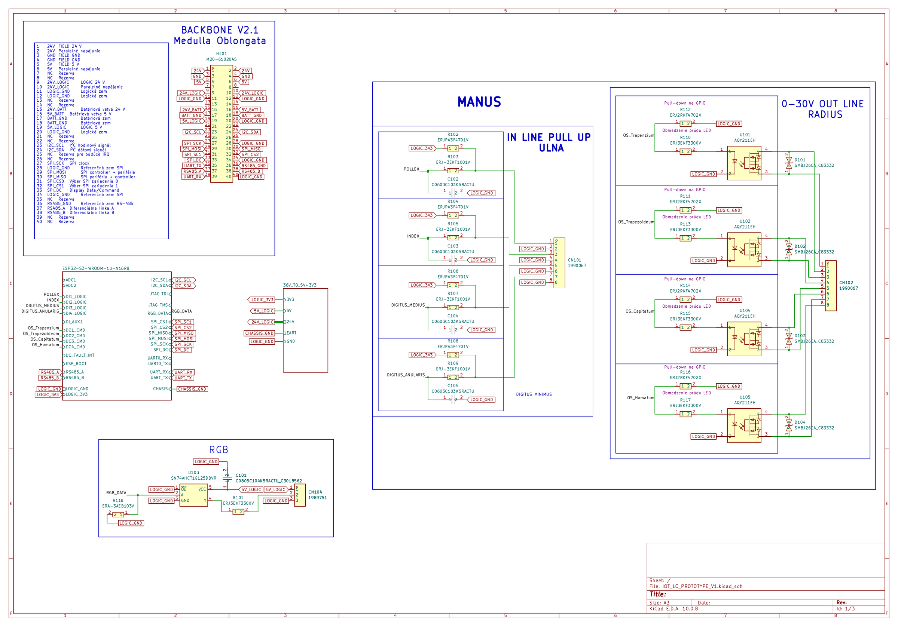
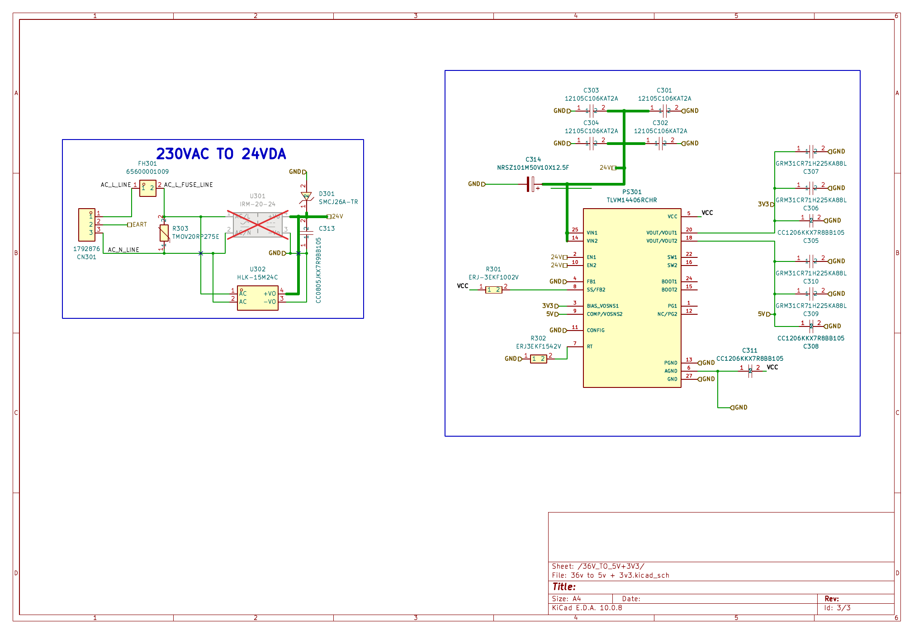
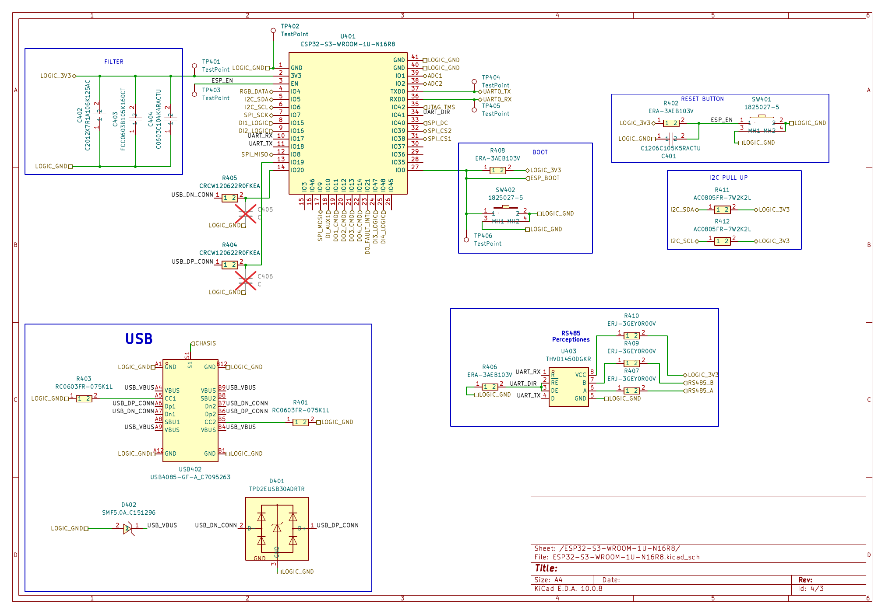
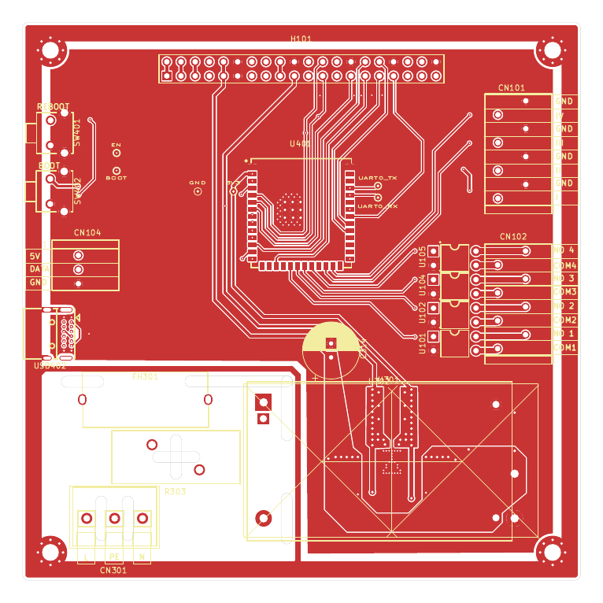
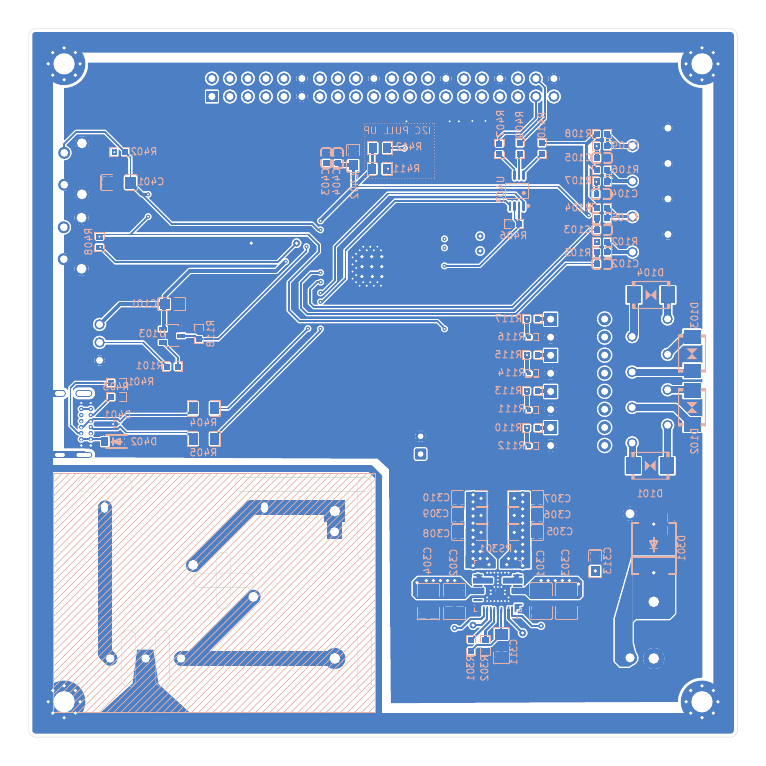
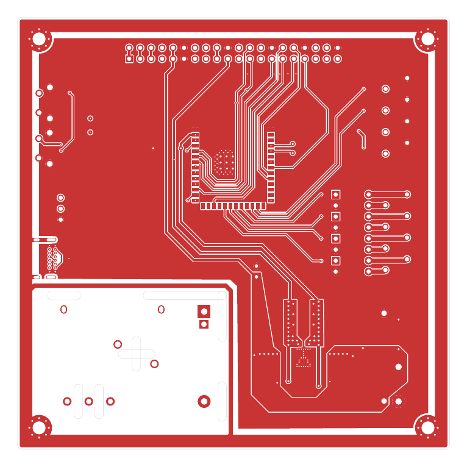
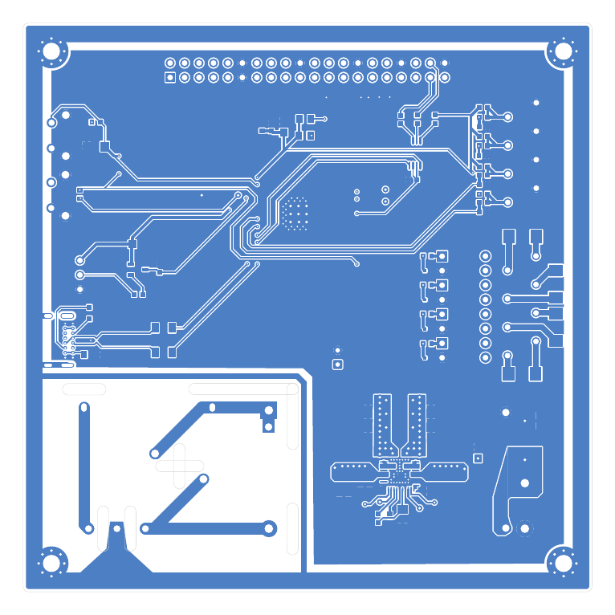
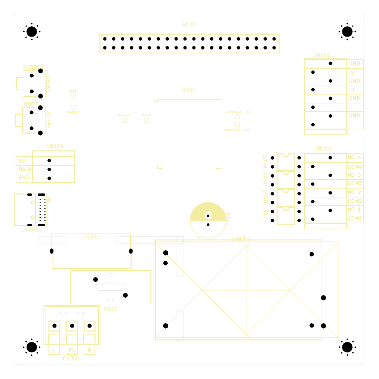
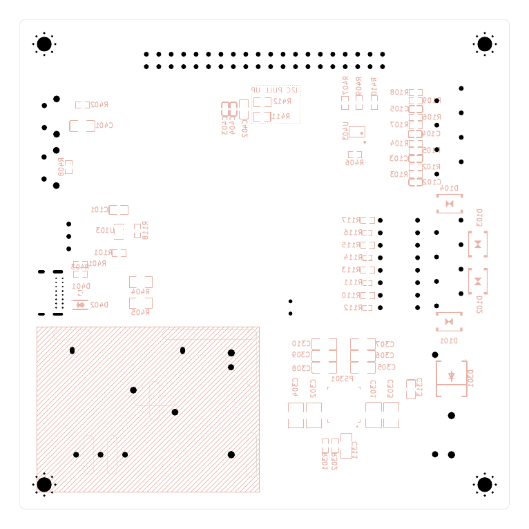

# IOT_LC_PROTOTYPE_V1

Modular IoT controller — custom PCB hardware project designed in KiCad 10.

**Status:** Work in progress — prototype, not validated for production.

This repository contains the KiCad schematic, PCB layout, design rules, and generated technical documentation.

> **Safety:** The design includes mains-voltage circuitry. It has not been certified or validated for safe mains operation. Do not assume that the published design is safe to manufacture or energize.

## Project Files

- `IOT_LC_PROTOTYPE_V1.kicad_pro` — KiCad project configuration
- `IOT_LC_PROTOTYPE_V1.kicad_sch` — Main schematic
- `IOT_LC_PROTOTYPE_V1.kicad_pcb` — PCB layout
- `IOT_LC_PROTOTYPE_V1.kicad_dru` — Custom design rules
- `*.kicad_sch` — Hierarchical schematic sheets

## Automation Scripts

### `scripts/export-pdf.sh`

Generates vector PDF documentation and PNG previews for this README.

```bash
./scripts/export-pdf.sh
```

Requirements: KiCad CLI 10 and `poppler-utils`.

### `scripts/auto-git.sh`

Automatically commits saved project changes and pushes them to GitHub.

- Runs through a local systemd user timer.
- Checks for changes approximately every 15 minutes.
- Respects `.gitignore`.
- Creates commits only when changes exist.
- Does not use force push.

The timer is configured locally and is not installed automatically when cloning this repository.

## Documentation

PDF and PNG files in `docs/` are generated from the KiCad source files.

The README displays PNG previews. The linked PDF files provide vector-quality documentation.

## License

No license has been specified. All rights reserved unless a license is added.

<!-- AUTO-DOCS-START -->
## Schematic documentation

### Complete active hierarchical schematic

**Page 1**



**Page 2**



**Page 3**



[View vector PDF](docs/pdf/schematic.pdf)

## PCB documentation

### PCB front

**Page 1**



[View vector PDF](docs/pdf/pcb-front.pdf)

### PCB back

**Page 1**



[View vector PDF](docs/pdf/pcb-back.pdf)

### Individual PCB layers

**Page 1**



**Page 2**



**Page 3**



**Page 4**



[View vector PDF](docs/pdf/pcb-layers.pdf)
<!-- AUTO-DOCS-END -->
